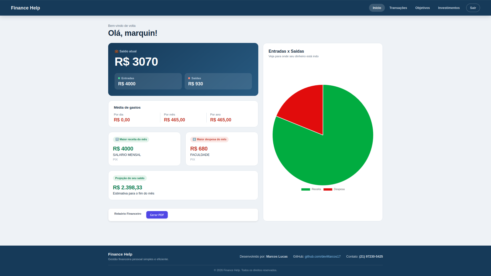
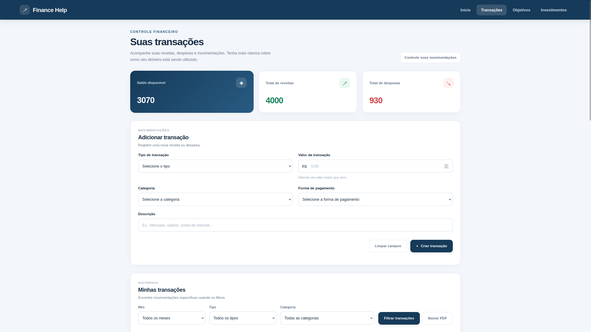
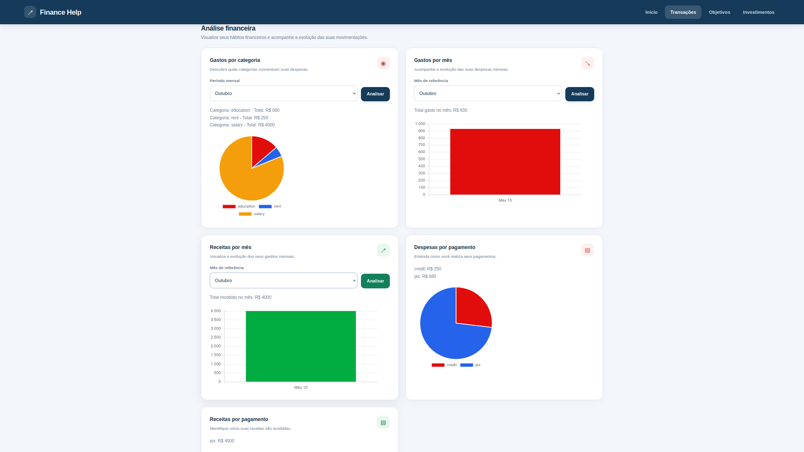
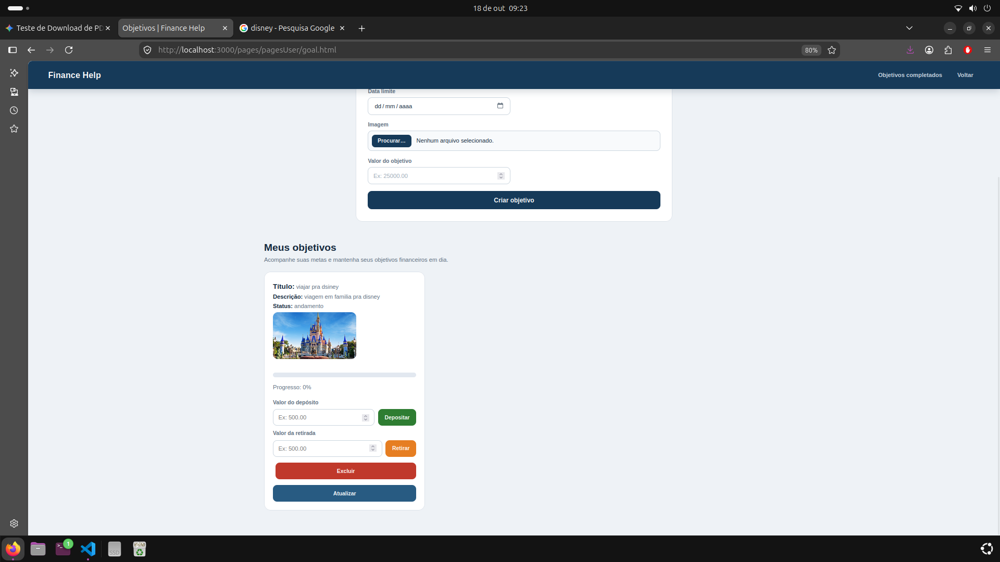
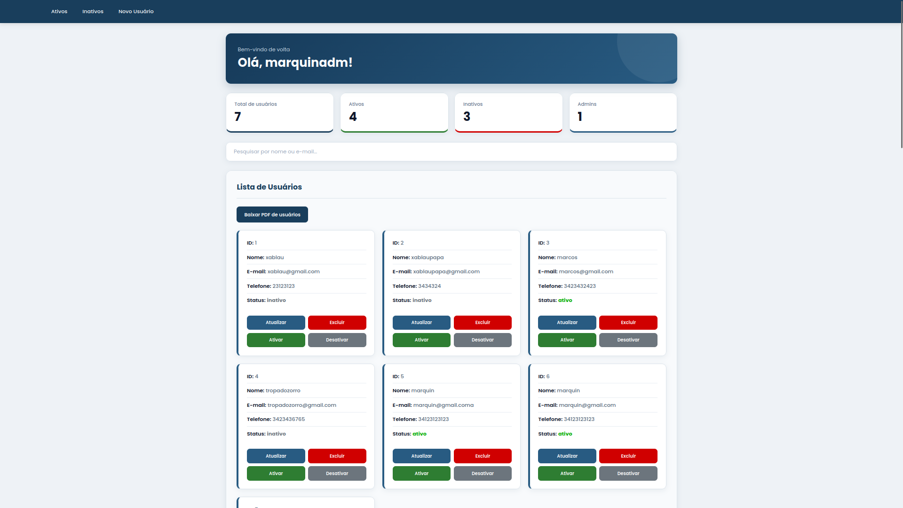
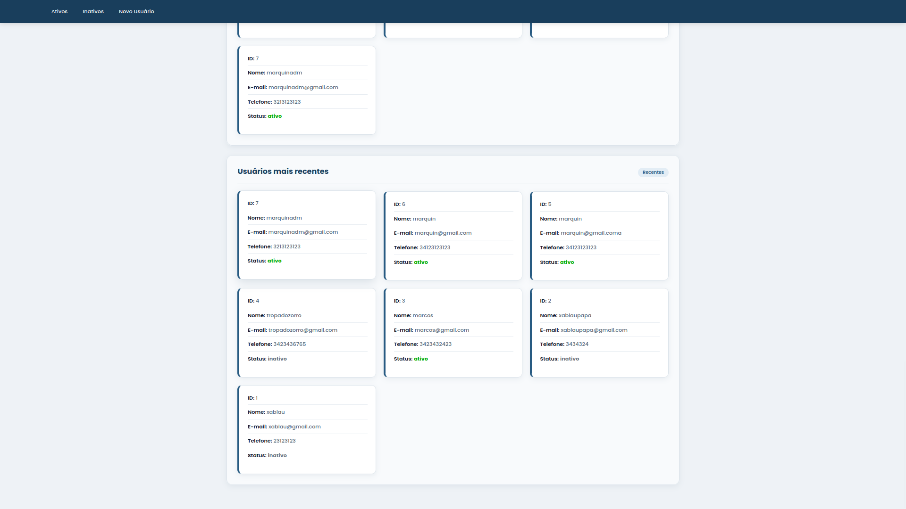

# 💰 FinancesHelp

O **FinancesHelp** é uma aplicação focada no controlo e gestão financeira pessoal. O objetivo principal da ferramenta é ajudar o utilizador a ter uma visão clara da sua saúde financeira, permitindo gerir entradas, saídas, investimentos e acompanhar o progresso de metas financeiras em tempo real.

---

## 📌 O que o FinancesHelp faz?

- **Gestão de Transações:** Registo e controlo de receitas (entradas) e despesas (saídas).
- **Acompanhamento de Metas:** Criação de objetivos financeiros (ex.: viagens, reservas de emergência) com barra de progresso visual.
- **Relatórios em PDF:** Geração e download de relatórios detalhados com listagens de dados e métricas.
- **Autenticação Segura:** Login e registo de utilizadores com sessões protegidas por token.
- **Painel Administrativo & Utilizador:** Ambientes distintos para a gestão geral do sistema e para a utilização individual.

---

## 📸 Screenshots da Aplicação

### 👤 Área do Utilizador
<p align="center">
  
  
</p>
<p align="center">
  
  
</p>

---

### 🛡️ Painel Administrativo
<p align="center">
  
  
</p>

---

## 🛠️ Tecnologias Utilizadas

- **PHP**: Linguagem backend principal utilizada para a construção da lógica de negócio.
- **Laravel**: Framework PHP robusto para estruturação das rotas, controllers e serviços.
- **Arquitetura MVC (Model-View-Controller)**: Organização do código focada em separar a camada de dados, regras de negócio e apresentação.
- **APIs (REST)**: Comunicação estruturada em JSON entre o frontend e o backend.
- **JWT (JSON Web Tokens)**: Autenticação segura via tokens para proteger os endpoints da API.
- **SQLite**: Base de dados leve e eficiente para armazenamento rápido das informações.
- **Docker**: Conteinerização de todo o ambiente de desenvolvimento para garantir a fácil execução da aplicação.
- **GitHub**: Controlo de versões e alojamento do código-fonte do projeto.

---

## 🚀 Como Executar o Projeto

### Pré-requisitos
- [Docker](https://www.docker.com/) e Docker Compose instalados
- [Git](https://git-scm.com/)

### Passo a Passo

1. **Clonar o repositório:**
   ```bash
   git clone [https://github.com/seu-usuario/FinacesHelp.git](https://github.com/seu-usuario/FinacesHelp.git)
   cd FinacesHelp
